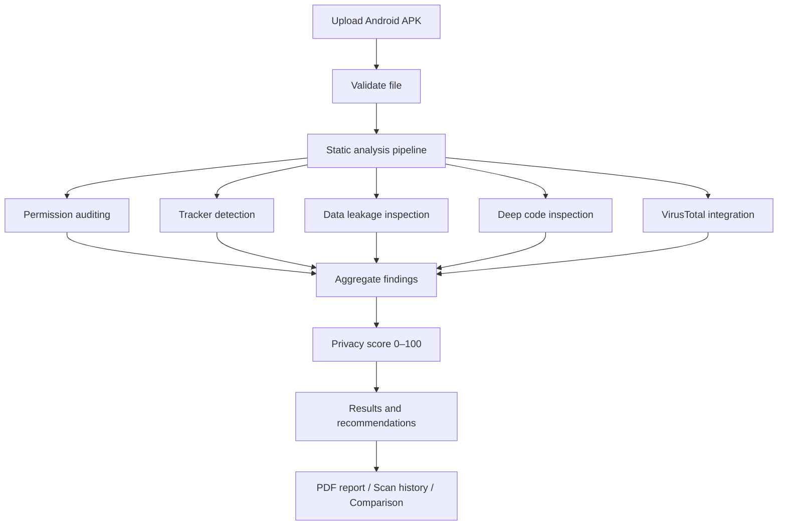

<div align="center">

# 🛡️ PrivacyGuard
### Android APK Privacy & Security Analysis Platform

**Multi-Module Static Inspection · Automated Privacy Scoring · Explainable Security Insights**

    

**Final Year Project · BSc (Hons) Computer Science (Cyber Security) · Asia Pacific University · 2026**

</div>

---

## Overview

**PrivacyGuard** is a web-based Android APK privacy and security assessment platform designed to make complex mobile-security findings understandable to non-technical users. Users upload an Android APK, and the platform combines findings from five analysis modules into a **privacy score from 0 to 100**, accompanied by risk explanations and actionable recommendations.

The project addresses a practical problem: users often cannot easily understand requested permissions, embedded trackers, potential data leakage, or code-level security weaknesses before installing an application.


## Core analysis modules

| Module | Purpose |
|---|---|
| **Permission Auditor** | Extracts and categorizes Android permissions and flags privacy-sensitive requests. |
| **Tracker Detector** | Identifies known embedded third-party tracking libraries using signature matching. |
| **Data Leakage Detector** | Statically inspects indicators of sensitive-data collection and network endpoints. |
| **Deep Code Inspector** | Inspects decompiled APK content for hardcoded secrets and weak cryptographic patterns. |
| **Malware Scanner** | Integrates VirusTotal API results as an additional malware-risk signal. |

> **Analysis boundary:** Static indicators are not proof that an application actually transmitted data or behaved maliciously at runtime. A privacy score is an assessment aid, not a guarantee of safety.

## Key platform capabilities

- **Automated privacy scoring:** consolidated 0–100 score with risk classification and recommendations.
- **Single APK analysis:** upload and review permissions, trackers, certificate details, endpoints and risk findings.
- **Side-by-side comparison:** compare two APKs using their security and privacy metrics.
- **Batch analysis:** analyze multiple APKs in one workflow (up to 10, as documented in the report).
- **Scan history and trends:** review stored results and changes across app versions.
- **Analytics dashboard:** visual summaries of risk distributions and commonly detected permissions.
- **AI chat assistant:** natural-language assistance with interpreting privacy findings via OpenRouter integration.
- **PDF reporting:** export analysis results in a readable report.

## System architecture

The system uses a **Flask-based application layer**, an APK analysis layer, a web presentation layer and **SQLite** for scan history. The implementation documented in the FYP also uses **Androguard**, **APKTool**, **VirusTotal**, and web frontend technologies.


### Analysis workflow



## Application screenshots

*The screenshots below are extracted from the completed FYP report and show the documented application interface.*

### 1. APK upload and analysis


### 2. Privacy scoring and results


### 3. APK comparison


### 4. Scan history and analytics


### 5. Batch analysis


### 6. AI assistance and deep inspection


## Technology stack

| Layer | Technologies documented in the FYP |
|---|---|
| Backend | Python, Flask |
| Frontend | HTML, CSS, JavaScript, Bootstrap, Chart.js |
| APK inspection | Androguard, APKTool; static analysis routines |
| Malware intelligence | VirusTotal API |
| AI integration | OpenRouter API |
| Data persistence | SQLite |
| Reporting | PDF generation in Python |

## Research and evaluation

The project included a **43-person user survey**. In the report, **97.7%** of respondents expressed concern about application privacy risks, and **95.3%** indicated willingness to use a free web-based APK analysis tool. The report also documents functional testing and user acceptance testing.

These findings describe the project's research sample; they are not population-wide estimates.

## Scope and limitations

- Supports **Android APK files**, not iOS applications.
- Requires **manual APK upload**; it does not directly scan installed apps.
- Documented upload size limit: **100 MB per APK**.
- Relies primarily on **static inspection** and third-party API results; runtime behavior may differ.
- Detects and explains potential risks but does not automatically remove or block applications.
- API-backed capabilities depend on valid credentials, service availability and usage limits.

## Repository contents

```text
PrivacyGuard-GitHub/
├── README.md
├── assets/
│   └── screenshots/       # Actual screenshots and architecture extracted from the FYP report
├── docs/
│   └── SOURCE_CODE_CHECKLIST.md
└── .gitignore
```

**Source code availability:** This portfolio package is based on the FYP report. It includes real project screenshots and documentation, **not the complete executable Flask application**. Original source files should be added separately before claiming the repository can be installed or run.

## Future improvements

Potential next steps include optional dynamic analysis, improved tracker signature coverage, more comprehensive privacy-risk validation, and deployment hardening.

## Academic project

**Developed by:** Fairouz Abdulrahman Hamed Mousa  
**Degree:** BSc (Hons) Computer Science (Cyber Security)  
**Institution:** Asia Pacific University of Technology & Innovation (APU)  
**Supervisor:** Ts. Umapathy Eaganathan  
**Year:** 2026

---

<div align="center">

**PrivacyGuard — Making Android privacy risks more visible, understandable, and actionable.**

</div>
