# 🛡️ PrivacyGuard
### Android APK Privacy & Security Analysis Platform

**Multi-Module Static Inspection | Automated Privacy Scoring | Explainable Security Insights**


**Final Year Project | BSc (Hons) Computer Science (Cyber Security)**  
**Asia Pacific University of Technology & Innovation | 2026**

---

## 📌 Project Overview

**PrivacyGuard** is a web-based Android APK privacy and security analysis platform developed to help users understand the potential privacy risks associated with Android applications before installing them.

The platform integrates **five security analysis modules** into a unified system, providing comprehensive APK inspection and an automated **privacy score ranging from 0 to 100**.

Unlike traditional security tools that often require advanced technical knowledge, PrivacyGuard focuses on accessibility, transparency, and explainable security insights.

The platform transforms complex technical findings into clear visual reports, risk classifications, and actionable security recommendations.

### 🎯 Project Objectives

- Improve transparency regarding Android application permissions.
- Detect embedded third-party tracking libraries.
- Identify potential sensitive-data collection and leakage indicators.
- Examine application code for security weaknesses.
- Generate an automated and standardized privacy score.
- Make Android privacy analysis accessible to non-technical users.

---

## 🖥️ Application Interface

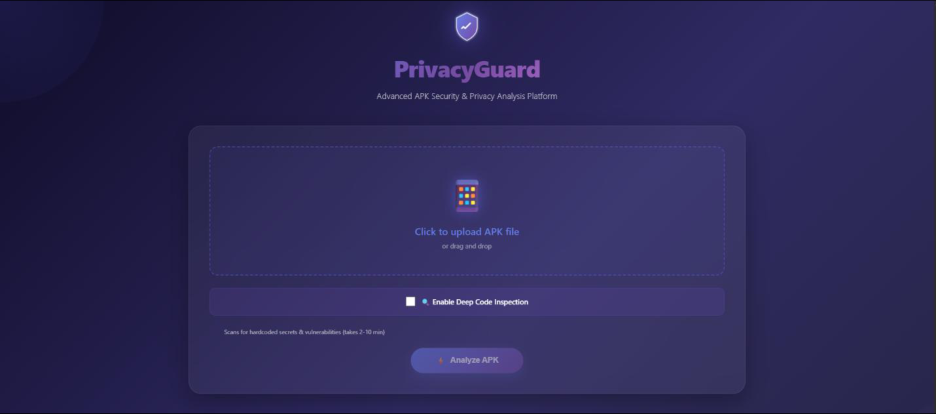

PrivacyGuard provides an intuitive web interface where users can upload Android APK files and initiate automated privacy and security assessments.

### Core Platform Features

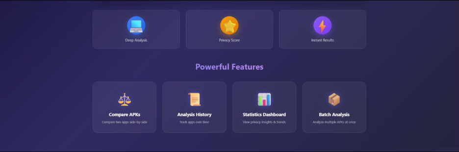

---

## 🔐 Five Core Security Analysis Modules

| Module | Description |
|--------|-------------|
| 🔑 Permission Auditor | Extracts Android permissions, categorizes their sensitivity, and identifies potentially dangerous requests. |
| 🕵️ Tracker Detector | Detects known third-party tracking libraries through signature-based inspection. |
| 🌐 Data Leakage Detector | Identifies potential sensitive-data collection and network communication indicators. |
| 💻 Deep Code Inspector | Examines decompiled application content for hardcoded secrets, insecure cryptographic practices, and other weaknesses. |
| 🛡️ Malware Scanner | Integrates VirusTotal API results to provide additional malware detection information. |

These modules contribute to a unified privacy assessment, helping users understand application risks through multiple security perspectives.

**Security Note:** PrivacyGuard primarily performs static analysis. Detected indicators do not necessarily prove malicious behavior or actual data transmission.

---

## ✨ Key Features

### 1. Automated APK Privacy & Security Analysis

Users upload an APK file, and PrivacyGuard automatically initiates the analysis process.

The platform examines application metadata, permissions, embedded trackers, security indicators, and other privacy-related characteristics.

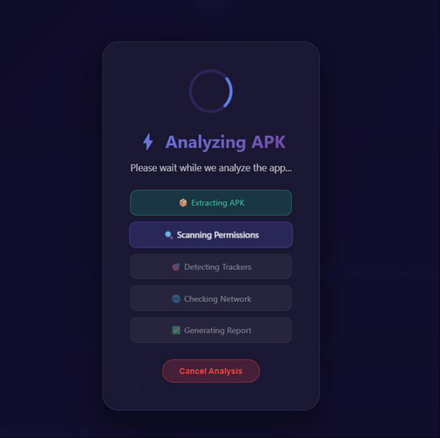

### 2. Automated Privacy Scoring

PrivacyGuard implements a weighted scoring mechanism that combines findings from multiple analysis modules.

Each analyzed application receives a standardized **privacy score between 0 and 100**, accompanied by a risk classification and security recommendations.

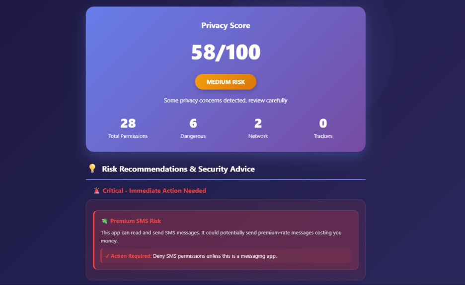

The scoring system is intended to help users interpret privacy risks rather than guarantee that an application is safe.

### 3. Detailed Security Analysis Results

PrivacyGuard provides structured reports containing:

- Application information and metadata.
- Permission classifications.
- Embedded tracker findings.
- Certificate and signature information.
- Network endpoints and detected domains.
- Potential code-level security weaknesses.
- Privacy recommendations.

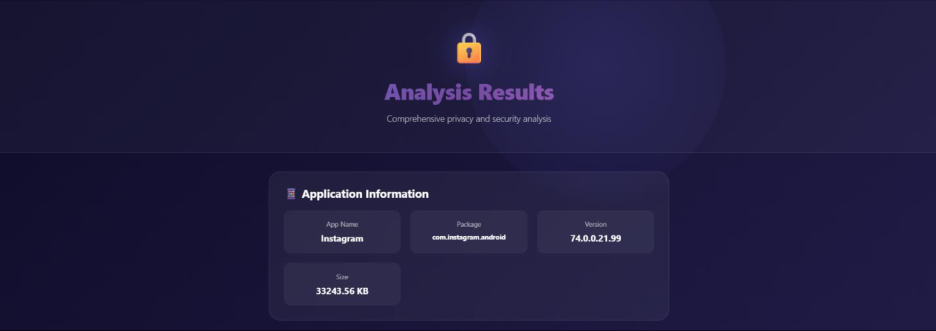

### 4. Android Permission Auditing

The permission auditing module identifies and categorizes Android application permissions.

Particular attention is given to privacy-sensitive permissions involving personal information and device functionality.

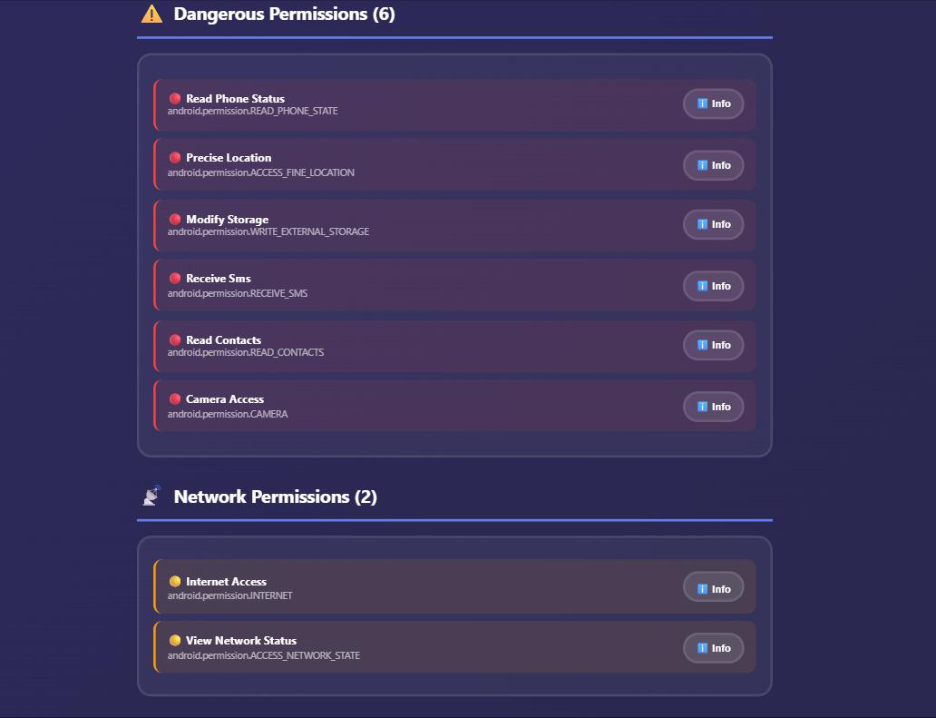

### 5. APK Comparison

PrivacyGuard enables users to compare two Android APK files.

The comparison feature evaluates privacy scores, permissions, tracking libraries, and other security indicators.

This allows users to identify differences between applications and make more informed decisions.

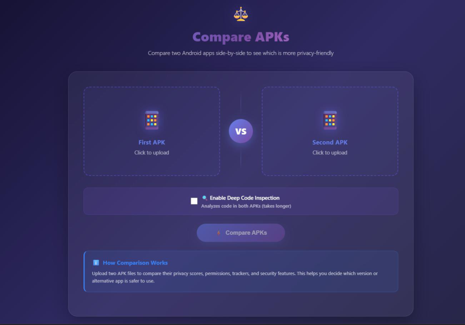

#### Comparison Results

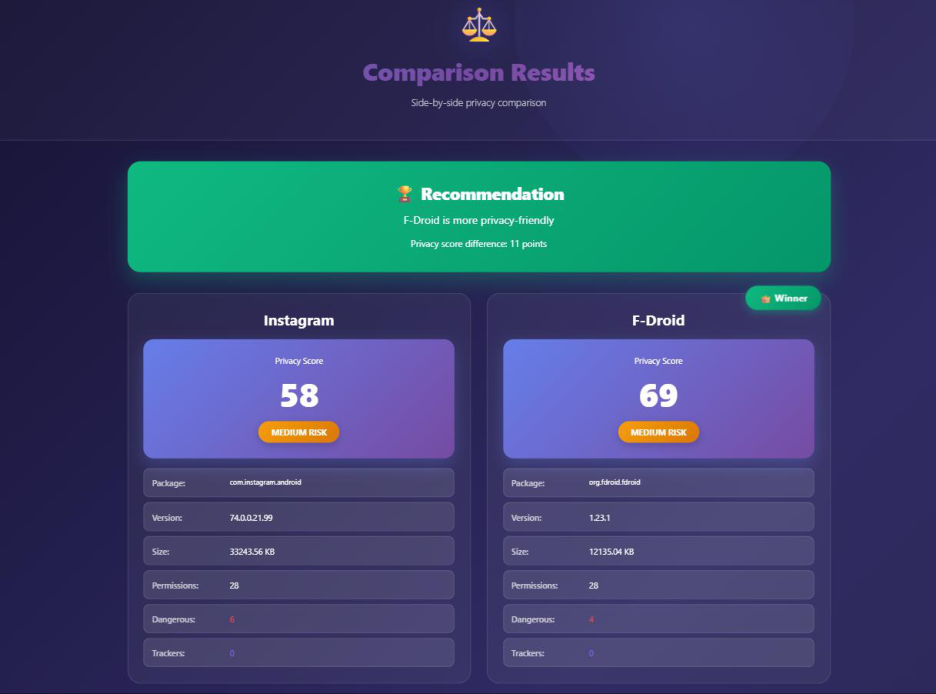

### 6. Batch APK Analysis

The platform supports analyzing multiple APK files within a single workflow.

Users can analyze up to **10 APK files per batch**, according to the documented project implementation.

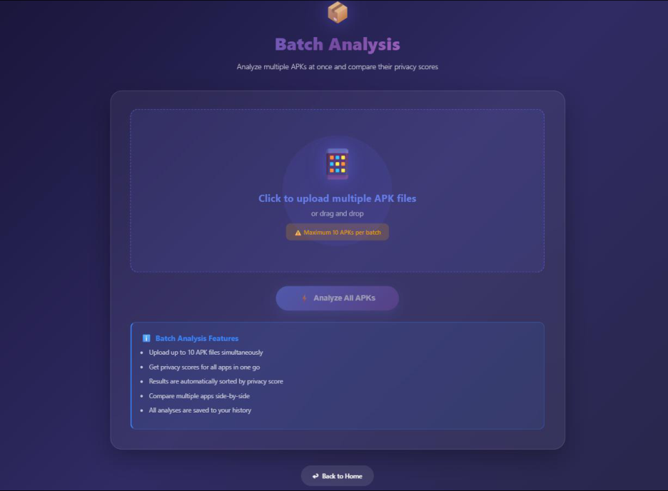

#### Batch Analysis Results

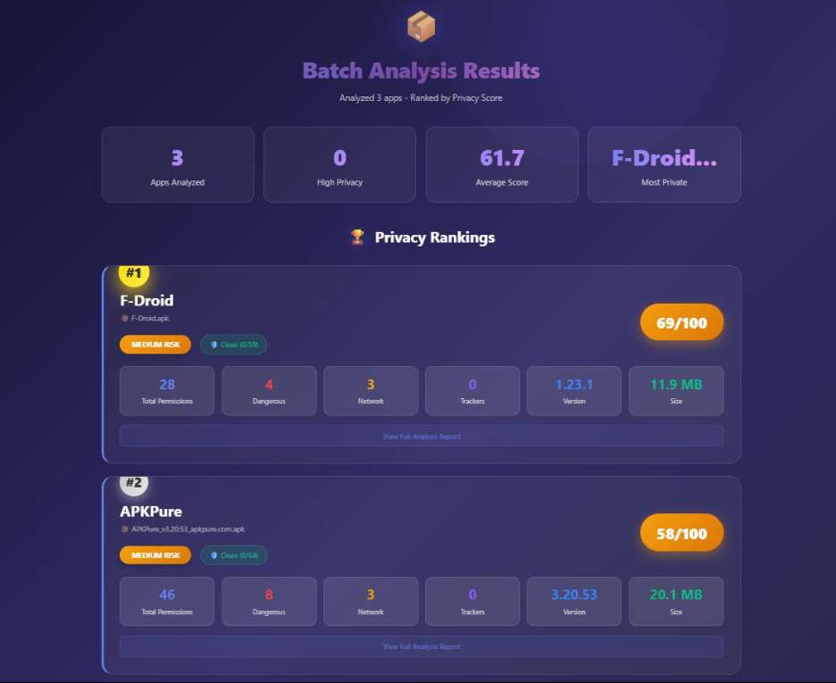

### 7. Scan History and Privacy Trends

PrivacyGuard uses SQLite to store analysis history.

Users can review previously analyzed applications, compare results across application versions, and monitor changes in privacy scores.

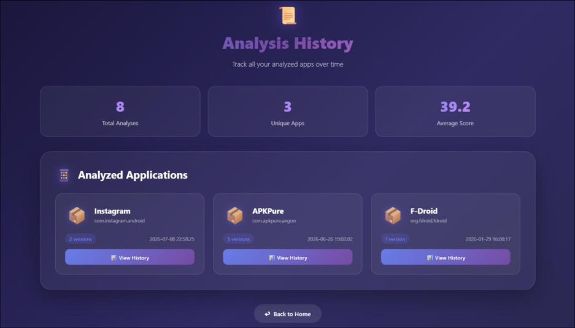

### 8. Analytics Dashboard

The analytics dashboard provides visual summaries of security and privacy findings.

Features include:

- Privacy score distributions.
- Commonly detected dangerous permissions.
- Application privacy rankings.
- Privacy score trends over time.
- Aggregated analysis statistics.

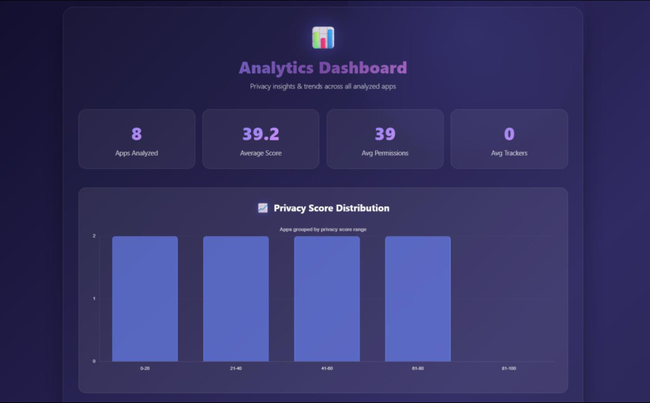

### 9. AI-Powered Security Assistant

PrivacyGuard integrates an AI chat assistant through the OpenRouter API.

The assistant helps users understand technical security findings through natural-language explanations.

Users can ask questions about detected risks, permissions, trackers, and recommended privacy practices.

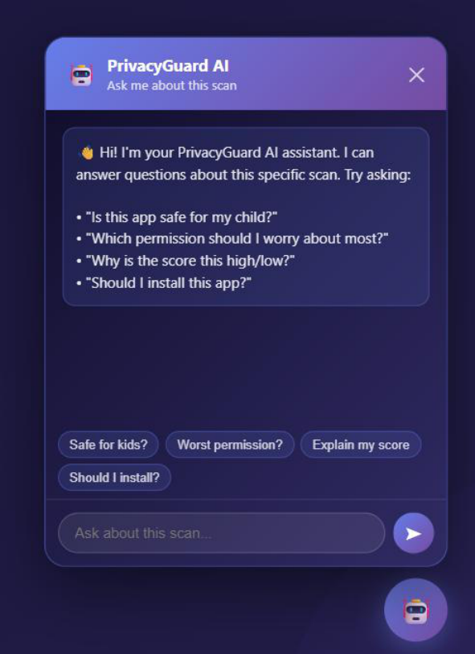

### 10. Deep Code Inspection

The Deep Code Inspector examines decompiled Android application content to identify potential security weaknesses.

Analysis includes indicators such as:

- Hardcoded credentials and API keys.
- Weak cryptographic algorithms.
- Insecure implementation patterns.
- Other detectable code-level security concerns.

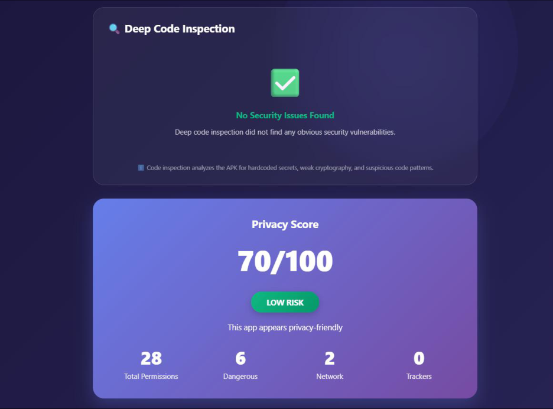

### 11. Data Leakage Analysis

The Data Leakage Detector examines static indicators associated with sensitive-data collection and network communication.

It helps identify potential privacy exposure involving information such as location data and other sensitive application data.

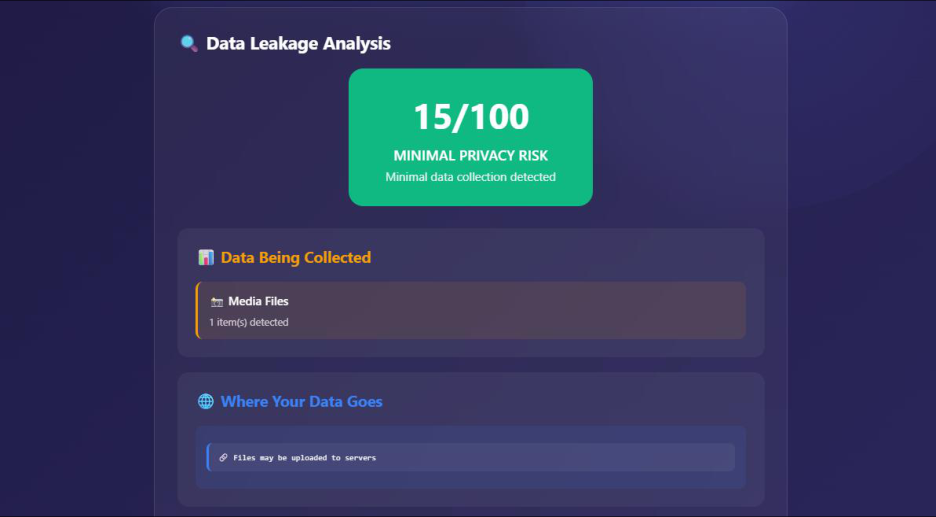

### 12. PDF Security Reports

PrivacyGuard supports generating downloadable PDF reports containing application information, security findings, privacy scores, and recommendations.

This allows users to retain and review their analysis results.

---

## 🏗️ System Architecture

PrivacyGuard follows a layered architecture that separates the user interface, application logic, security analysis components, and data persistence.

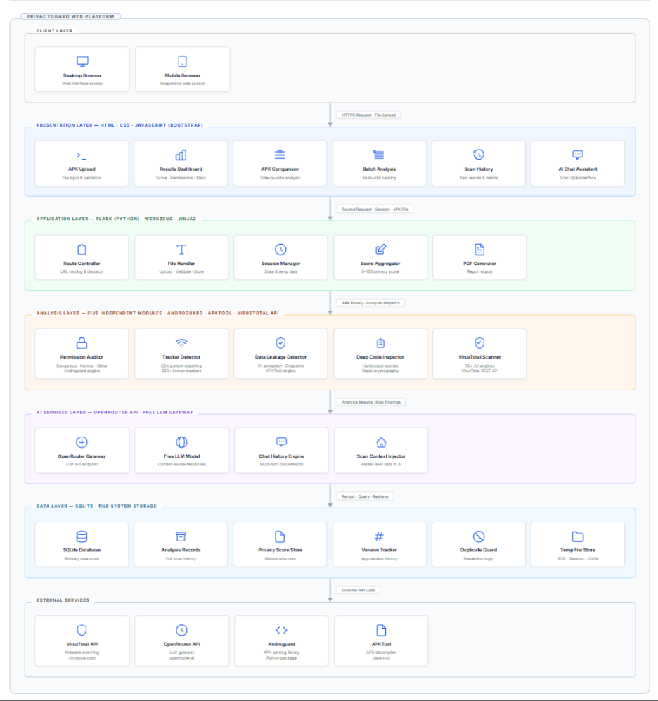

### Architecture Components

**1. Presentation Layer**

- HTML, CSS, and JavaScript interface.
- APK upload and validation.
- Analysis progress visualization.
- Results and comparison dashboards.
- AI assistant interface.

**2. Application Layer**

- Python Flask backend.
- Upload handling and analysis orchestration.
- API integrations.
- Privacy score calculation.
- PDF report generation.

**3. Security Analysis Layer**

- Permission Auditor.
- Tracker Detector.
- Data Leakage Detector.
- Deep Code Inspector.
- VirusTotal Malware Scanner.

**4. Data Layer**

- SQLite database.
- Scan history and analysis records.
- Application version comparisons.
- Stored privacy analysis results.

---

## 🔄 Analysis Workflow

The general PrivacyGuard workflow is:

```text
          Android APK Upload
                  |
                  v
         APK File Validation
                  |
                  v
        Application Inspection
                  |
        +---------+---------+
        |         |         |
        v         v         v
    Permission  Tracker   Data Leakage
     Auditor    Detector    Detector
        |         |         |
        +---------+---------+
                  |
                  v
        Deep Code Inspection
                  |
                  v
       VirusTotal Integration
                  |
                  v
        Privacy Scoring Engine
                  |
                  v
       Risk Classification
                  |
                  v
      Security Recommendations
                  |
                  v
       Results and Dashboard
                  |
          +-------+-------+
          |               |
          v               v
     PDF Report       Scan History
```

The exact analysis steps depend on enabled modules and the availability of external services.

---

## 🛠️ Technology Stack

| Category | Technologies |
|----------|--------------|
| Programming Language | Python |
| Backend Framework | Flask |
| Frontend | HTML5, CSS3, JavaScript |
| UI Framework | Bootstrap |
| Data Visualization | Chart.js |
| APK Static Analysis | Androguard |
| APK Decompilation | APKTool |
| Malware Intelligence | VirusTotal API |
| AI Integration | OpenRouter API |
| Database | SQLite |
| PDF Generation | Python PDF reporting libraries |
| Development Environment | Visual Studio Code |

---

## 📊 Research and Evaluation

PrivacyGuard was developed as part of an academic research project investigating Android application privacy awareness and the accessibility of existing security analysis tools.

A user survey involving **43 respondents** was conducted to evaluate privacy concerns and the demand for accessible APK analysis solutions.

### Research Findings

| Research Indicator | Result |
|-------------------|--------|
| Survey Participants | 43 |
| Respondents Concerned About Application Privacy | 97.7% |
| Respondents Willing to Use a Free APK Analysis Tool | 95.3% |

These results represent the research sample and are not intended as population-wide estimates.

The project also included functional testing and user acceptance testing to evaluate the system's implemented features and usability.

---

## ⚠️ Scope and Limitations

PrivacyGuard was developed as a static Android APK analysis platform.

Its current documented limitations include:

- Supports Android APK files only.
- Does not support iOS application analysis.
- Requires manual APK uploads.
- Supports APK files up to 100 MB.
- Does not directly inspect installed applications.
- Static findings cannot confirm all runtime behaviors.
- VirusTotal integration depends on API availability and credentials.
- The platform identifies and explains risks but does not automatically remove malicious applications.
- Privacy scores are decision-support indicators, not guarantees of application safety.

---

## 📁 Repository Structure

```text
PrivacyGuard/
│
├── README.md
│
├── home.png
├── features.png
├── architecture.png
├── analysis-progress.png
├── analysis-results.png
├── privacy-score.png
├── permissions.png
├── compare-upload.png
├── comparison-results.png
├── scan-history.png
├── analytics-dashboard.png
├── batch-analysis.png
├── batch-results.png
├── ai-assistant.png
├── deep-code-inspection.png
└── data-leakage.png
```

**Source Code Availability:** This repository documentation is based on the completed Final Year Project report. The screenshots represent the developed application. The complete executable source code and installation instructions can be added separately.

---

## 🚀 Future Enhancements

Potential future improvements include:

- Integrating dynamic analysis capabilities.
- Expanding third-party tracker detection coverage.
- Improving privacy risk scoring and validation.
- Enhancing automated security recommendations.
- Supporting additional APK inspection techniques.
- Strengthening application deployment security.
- Improving performance for large-scale APK analysis.

---

## 🎓 Academic Information

**Project Title:** Android APK Privacy and Security Analysis with Multi-Module Static Inspection and Automated Privacy Scoring

**Project Name:** PrivacyGuard

**Developed By:** Fairouz Abdulrahman Hamed Mousa

**Degree:** Bachelor of Science (Honours) in Computer Science (Cyber Security)

**Institution:** Asia Pacific University of Technology & Innovation (APU), Malaysia

**Project Supervisor:** Ts. Umapathy Eaganathan

**Year:** 2026

---

## 🎯 Project Contribution

PrivacyGuard demonstrates the integration of multiple Android application security inspection techniques into a single, accessible web-based platform.

The project combines cybersecurity analysis, privacy risk assessment, automated scoring, data visualization, and AI-assisted explanations to help users better understand potential privacy threats.

It reflects practical experience in:

- Mobile application security.
- Static application security testing.
- Python web application development.
- Security API integration.
- Database management.
- Automated risk assessment.
- Cybersecurity reporting and visualization.

---

### 🛡️ PrivacyGuard
**Making Android Privacy Risks More Visible, Understandable, and Actionable.**

*Developed as a Final Year Project at Asia Pacific University of Technology & Innovation, 2026.*
